<!-- themed-header:start -->

  
  

**At a glance**

- Designed a normalized Oracle database for 3 simulated farms that tracks 50,000+ crop, nutrient, environmental, inventory and harvest transactions.
- Wrote PL/SQL packages, triggers, governed SQL views and role-based access controls, cutting analytical query time by 45% and report preparation time by 50%.

---
<!-- themed-header:end -->

# Smart Hydroponic Farm Management System

An Oracle SQL / PL-SQL schema for running hydroponic greenhouses. It covers
plant beds, crop growth cycles, sensor monitoring, harvests and customer
orders, with role-based access for technicians, agronomists and sales
managers. See [ProjectERD.md](ProjectERD.md) for the ER and data-flow diagrams.

## Schema

All tables are created by `create_tables.sql` in the `hydro_admin` schema:

| Table | Purpose |
|-------|---------|
| `CUSTOMERS` | Retail and wholesale customers (unique email) |
| `GREENHOUSES` | Greenhouse locations and slot counts |
| `CROP_TYPES` | Crops, growing conditions, harvest time, price per 100g |
| `PLANT_BEDS` | Beds in a greenhouse, with the current crop and growth cycle |
| `GROWTH_CYCLE` | A crop's cycle in a bed (Seedling, Vegetative, Flowering, Harvest) |
| `HARVESTED_CROPS` | Harvest yields and the quantity still available for sale |
| `SENSORS` | One sensor per bed and type (TEMPERATURE, HUMIDITY, PH) |
| `SENSOR_LOGS` | Timestamped sensor readings |
| `ORDERS` | Customer orders and their totals |
| `ORDER_ITEMS` | Order lines drawn from specific harvests |

Business logic lives in the packages in `stored_procedures.sql`
(`crop_mgmt_pkg`, `customer_mgmt_pkg`, `facility_mgmt_pkg`, `order_mgmt_pkg`,
`sensor_mgmt_pkg`, `harvest_mgmt_pkg`) plus the
`trg_growth_cycle_stage_change` trigger, which harvests and replants a bed
when its cycle reaches the Harvest stage.

## Steps to Execute

Run the scripts in this order with SQL*Plus, SQLcl or SQL Developer (run as a
script, F5). Several scripts prompt for passwords and a tablespace name.
No passwords are stored in this repository.

### 1. Create the project admin (log in as the database `ADMIN` user)

1. `admin_setup.sql` creates the `hydro_admin` user and grants its privileges.
   - Prompts for the new `hydro_admin` password.
   - Prompts for the quota tablespace: press Enter for `USERS`, or type `DATA`
     on Oracle Autonomous Database.

### 2. Build the schema (log in as `hydro_admin`, with the password from step 1)

2. `user_creation.sql` creates the roles (`technician_role`, `agronomist_role`,
   `sales_manager_role`, `customer_role`) and the users `hydro_technician`,
   `hydro_agronomist`, `hydro_sales_manager` and `hydro_customer`.
   It prompts for each user's password and for the same tablespace as step 1.
3. `create_tables.sql` creates the tables, constraints, indexes and public synonyms.
4. `stored_procedures.sql` creates the sequences, packages and trigger, and
   grants package and sequence access to the roles.
5. `role_grants.sql` grants table privileges to the roles.

### 3. Load data (stay logged in as `hydro_admin`)

6. `insert_admin_data.sql` creates the greenhouses, crop types, customers,
   plant beds, sensors and initial growth cycles.
7. Optional role sample data:
   - `insert_technician_data.sql` adds sensor readings for plant beds 1-3.
   - `insert_manager_data.sql` registers 15 more customers.
   - `insert_agronomist_data.sql` is an older standalone sample. It uses
     hardcoded IDs (crop types, growth cycles, plant beds and harvests
     starting at 1) that collide with the data from step 6, so skip it after
     running `insert_admin_data.sql`.
8. `project_simulation.sql` simulates four weeks of sensor readings, growth
   stage changes, harvests and orders.

### 4. Reports and views (still as `hydro_admin`)

9. `report_creation.sql` creates the crop views (`VW_CROP_INFO`,
   `VW_CROP_PLANTINGS`, `VW_CROP_PRODUCTION`, `VW_CROP_VALUE_ANALYSIS`,
   `VW_CROP_EFFICIENCY`).
10. `reports.sql` creates the analytics views (`VW_CROP_PERFORMANCE_ANALYSIS`,
    `VW_GREENHOUSE_EFFICIENCY`, `VW_CUSTOMER_ORDER_ANALYTICS`,
    `VW_ENVIRONMENTAL_MONITORING`, `VW_REVENUE_PRODUCTION_TRENDS`).
11. `view_scope.sql` prints all data and lists the schema objects
    (run with `SET SERVEROUTPUT ON`).

## Resetting

- `cleanup.sql` (as `hydro_admin`) drops the schema's triggers, public
  synonyms, packages, procedures, functions, sequences and tables, then
  prints what is left. Rerun from step 3 afterwards. `clean_sql.sql` is a
  variant of the same script.
- For a full reset, log in as `ADMIN` and run `DROP USER hydro_admin CASCADE;`
  (`admin_setup.sql` also does this automatically), then start again from
  step 1. `user_creation.sql` drops and recreates its roles and users, so it
  can be rerun on its own.

### Notes

- Run the steps in order to avoid missing parent key errors.
- If you ran an earlier version of these scripts, change any passwords that
  were set from values previously published in this repository.

Thank You.

Team 17 - Saaketh Ch, Satwika M, Likhith NG
